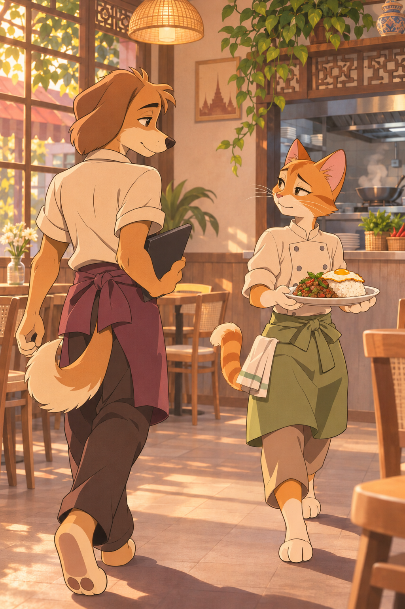

# แนวทางอนิเมชัน 2D หมา–แมวของ Pokpok

เจ้าของเปลี่ยนแนวทางเมื่อ 2026-11-21 หลังดูตัวอย่าง 3D แล้วต้องการคุณภาพภาพที่ดีขึ้น โดยเลือกอนิเมชัน 2D หมา–แมว สไตล์อนิเมะญี่ปุ่นผสมดิสนีย์



เจ้าของให้ปรับสีหน้าที่ดูเหมือน AI ให้เป็นธรรมชาติมากขึ้นในวันเดียวกัน เวอร์ชัน 2 ลดขนาดตาและการเบิกตา ปรับเป็นรอยยิ้มปิดปากเล็กน้อย และใช้คิ้ว/เปลือกตาที่ผ่อนคลาย โดยตีความเป็นอารมณ์มนุษย์ผ่านตัวละครหมา–แมว ภาพนี้ยังเป็นต้นแบบสไตล์สำหรับตรวจ

## ภาพและบทบาทตัวละคร

ภาพต้นแบบสร้างขึ้นใหม่ด้วยเครื่องมือ ImageGen ในแชตนี้ ใช้เส้นวาด เงาแบบ cel shading ฉากลงสีโทนอุ่น และสีหน้าที่สื่ออารมณ์ชัดเจน ผู้ช่วยเลือกให้หมาสีน้ำตาลครีมเป็นพนักงานถือแท็บเล็ต และแมวสีส้มขาวเป็นพนักงานครัวถืออาหาร เพื่อให้เข้ากับเรื่องรายการอาหารและโต๊ะ

ใช้ภาพนี้อ้างอิงหน้าตา สัดส่วน เสื้อผ้า และบรรยากาศสำหรับภาพช็อตต่อไป ภาพต้นแบบเป็น PNG รวมฉากกับตัวละคร ขั้นผลิตควรสร้างภาพตัวละครพื้นโปร่งใส ท่าทางและสีหน้าที่จำเป็น พร้อมฉากแยก เพื่อทำการกะพริบตา หันหน้า ขยับแขน และส่งอาหารได้

ไฟล์ปัจจุบันอยู่ที่ `docs/previews/pokpok-2d-dog-cat-concept-v2.png` และแนบใน POK-14 ด้วย attachment ID `3447ef56-5e26-44e0-bef1-a7ea2eefd38e` ตรวจไฟล์ที่ดาวน์โหลดกลับแล้ว SHA-256 ตรงกับต้นฉบับ เก็บเวอร์ชันแรกที่ `pokpok-2d-dog-cat-concept.png` เพื่ออ้างอิงการแก้ไข

## การปรับงานผลิต

- เปลี่ยนทิศทางภาพของ POK-11 และ POK-14 เป็น 2D หมา–แมวตามคำสั่งเจ้าของล่าสุด เก็บตัวอย่าง 3D เดิมไว้ในประวัติงาน
- ใช้เรื่อง “รายการนี้ โต๊ะไหน” และความยาว 15 วินาทีตามบรีฟเดิมเป็นฐาน ปรับการแสดงให้เข้ากับตัวละครใหม่
- ตัวละคร ฉาก และอุปกรณ์ประกอบภาพสร้างใหม่เป็นชุดเดียวกัน ส่วนภาพหน้าจอ Pokpok ใช้ภาพจากแอปสาธิตที่ตรวจแหล่งข้อมูลได้ แล้วประกอบเข้าภาพแท็บเล็ตในขั้นผลิต
- ทีมทำ storyboard, รายการภาพแยกชั้น และงานภาพ 2D ที่พร้อมได้ต่อทันที ข้อขาดเรื่องภาพ UI และเสียงใน POK-15 ยังคงต้องจัดหาให้ครบตามเกณฑ์คลิปเดิม
- การเปลี่ยนสไตล์ครั้งนี้เดินต่อได้ตามคำสั่งเจ้าของ การโพสต์สาธารณะต้องได้รับอนุมัติชิ้นงานสุดท้ายและปลายทางจากเจ้าของ

## Prompt ที่ใช้สร้างภาพต้นแบบ

ใช้ built-in ImageGen และตั้ง `transparent_background=false`

```text
Create a polished ORIGINAL 2D animation visual-development keyframe for a Thai restaurant POS brand commercial. Vertical portrait composition for a short Reel. The user wants a blend of Japanese hand-drawn anime and classic Disney 2D feature animation appeal. Hand-inked expressive clean contours, restrained cel shading, soft painted background, beautiful appealing character acting, genuinely hand-drawn flat 2D animation aesthetic. Two original anthropomorphic adult restaurant staff characters: a warm tan and cream floppy-eared dog server with an expressive friendly face, cream short-sleeve shirt and muted plum-purple waist apron, carrying a dark tablet naturally at waist level, its back toward the camera; a smaller orange-and-white cat kitchen worker with alert ears, a cream chef jacket and sage-green apron, carrying a plate of Thai basil rice. Show a small moment of teamwork and eye contact, clear distinct silhouettes, natural appealing paws and anatomy. A charming contemporary Thai neighborhood restaurant with pale wood tables, a kitchen pass, a few plants and warm late-afternoon window light, tastefully sparse details. Medium-wide full-body shot, both characters prominent and easily readable on a phone. Cinematic but drawn staging, warm cream, apricot and muted sage palette with a restrained plum accent. No captions, no lettering, no logos, no watermarks, no readable or invented app UI. No existing copyrighted characters. Avoid 3D render appearance, plastic textures, photorealism, overly tiny chibi proportions and generic clipart. This is a visual style concept for review, emphasize beautiful finished illustration and emotional character appeal.
```

## Prompt ที่ใช้แก้สีหน้าเวอร์ชัน 2

ใช้ built-in ImageGen ในโหมดแก้ไข โดยอ้างอิงภาพเวอร์ชันแรก

```text
Edit this exact illustration with a focused facial acting revision. The user says the expressions feel AI-generated and wants more natural, human-observed emotion. Preserve the same original anthropomorphic DOG and CAT, their species, character identities, fur markings, outfits, body poses, tablet, food, restaurant background, warm light and overall composition. Revise both faces so they feel like carefully observed, hand-drawn acting by a skilled 2D character animator. Reduce the oversized eyes slightly, give the upper eyelids relaxed weight, reduce glossy catchlights, and make pupils/gaze clearly connect between the characters. The dog server is quietly checking with his coworker, with a small relaxed CLOSED mouth and an understated slight lift in one brow, a gentle attentive expression. The cat chef is focused on carrying the dish and listening to the dog, with a subtle CLOSED-mouth half-smile and relaxed cheeks, slightly asymmetric brows. Convey warm ordinary workplace rapport, not posing for a portrait. Use small natural asymmetries, believable cheek and eyelid tension, restrained expression and elegant varied ink lines. Remove the generic broad open-mouth smiles, toothy grins, permanently raised eyebrows, huge sparkling eyes, and exaggerated cute reaction. Keep the attractive Japanese-anime and classical hand-drawn feature-animation 2D aesthetic. Neither character becomes a human; retain their animal muzzles and ears, adapting human emotional nuance through their animal faces. Make this the same scene at the same moment, with more grounded, candid facial acting. No added text or logos.
```
